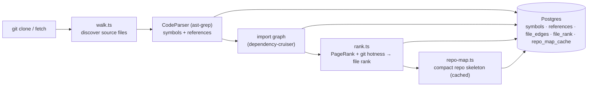

# `repo-intel` — the codebase indexer

`repo-intel` reads a cloned repository **once on clone** (and incrementally on
fetch, keyed by file content hash) and turns it into queryable facts: symbols,
the import graph, a PageRank-based file importance score, and a compact **repo
map** (the project skeleton). On a review it is only **read** — the index is
already computed, so adding context to a prompt costs no analysis at request time.

This is **starter infrastructure**: it works from day 1 (the **Indexed** badge),
but you don't write it. Later milestones build features _on top_ of its facade —
Blast Radius (L04), Conventions samples (L02), Onboarding reading-path (L05),
the Phantom-API gate (L06) — by calling `repoIntel.*`, not by re-indexing.

## Pipeline

Full vs incremental indexing lives in `pipeline/{full,incremental}.ts`; an
unindexed or partially-indexed repo degrades gracefully (the facade returns empty
results rather than throwing).

## Code layout (onion rings)

The module's core never touches Postgres, the filesystem or a native parser
directly: it talks to **ports** (`ports.ts`), and the composition root
(`platform/container.ts`) plugs in the adapters.

| Port (`ports.ts`) | Production adapter |
|---|---|
| `RepoIntelStore` | `repository.ts` (`RepoIntelRepository`, Drizzle) |
| `CodeParser` | `adapters/astgrep` (`AstGrepCodeParser`, @ast-grep/napi) |
| `CloneReader` | `adapters/clone-reader` (`FsCloneReader`: contained reads + the walk) |
| `DepGraph` | `adapters/depgraph` (dependency-cruiser) |
| `Tokenizer` | `adapters/tokenizer` (js-tiktoken) |
| `GitClient`, `CodeIndex`, `JobQueue` | shared ports in `@devdigest/shared` |

Use cases, each with a narrow deps object:

- `indexing.ts` — `RepoIndexer` (index / refresh / resync) and
  `registerRepoIntelJobHandlers`, called from `app.ts` `registerJobHandlers`.
  The pipelines (`pipeline/full.ts`, `incremental.ts`, `parse-file.ts`) take
  the same `IndexingDeps`; `rank.ts` and `repo-map.ts` are pure.
- `blast.ts` — `BlastRadiusQuery` (persistent index, else the ripgrep fallback).
- `callers.ts` — `CallerSignaturesQuery` (the review prompt's callers digest).
- `phantom.ts` — `UnresolvedReferencesQuery` (phantom-API gate).
- `index-queries.ts` — `IndexQueries` (repo map, file rank, symbols, top files, critical paths).
- `facts.ts` — pure endpoint / cron extractors.
- `service.ts` — `RepoIntelService`, the facade, delegating to the above.

Tests build these with fakes (`MockCloneReader` in `adapters/mocks.ts`, small
store literals), no container.

## Facade (`repoIntel.*`)

Everything downstream reads through one facade (`RepoIntelService` in
`service.ts`, reached as `container.repoIntel`) so consumers never touch the
pipeline internals:

- `getRepoMap(repoId)` → the cached repo skeleton (fed into the **review prompt**).
- `getFileRank(repoId, files)` → importance percentile per changed file.
- `getCallerSignatures(repoId, files, limit)` → callers of changed symbols.
- `getBlastRadius(repoId, files)` → impacted symbols / callers (used by L04).
- `getUnresolvedReferences(repoId, …)` → phantom-symbol detection (used by L06).
- `getConventionSamples(repoId)` → top-ranked files for convention extraction (L02).

In the starter, only `getRepoMap` / `getFileRank` / `getCallerSignatures` are
wired — into `modules/reviews/run-executor.ts`, which adds the repo map and a
high-blast-radius note to the prompt. Toggled by `REPO_INTEL_ENABLED` (global)
and a per-agent `repo_intel` flag.

### Callers digest: why it still greps the clone

`getCallerSignatures` finds callers with `CodeIndex.references` (ripgrep + the
regex extractor, walking and reading every source file of the clone, once per
changed symbol), even though the index already holds a `references` table.
That table is **not** an equivalent source, so switching would change the
review prompt:

- different extractor: ast-grep `parseReferences` vs the regex
  `extractReferences` (e.g. calls inside template literals, multi-line chains
  attributed to a different line);
- different file scope: the index skips `vendor/`, `out/`, files > 400 KB and
  caps at 5000 files; the ripgrep walk does not;
- different snapshot: the index is as of `last_indexed_sha`, the grep reads the
  working tree;
- different order: the digest is truncated at `limit` in reference order, and
  the walk order (readdir) differs from an unordered SQL read.

The persisted path is the planned speed-up (one `IN` query instead of a full
clone scan per symbol); it needs a decision on which of these differences are
acceptable, then a parity test on a real indexed repo, with the ripgrep path
kept for unindexed / `partial` repos.

## Routes

- `GET /repos/:id/index-state` — index status (drives the **Indexed** badge).
- `POST /repos/:id/resync` — enqueue a re-index.
